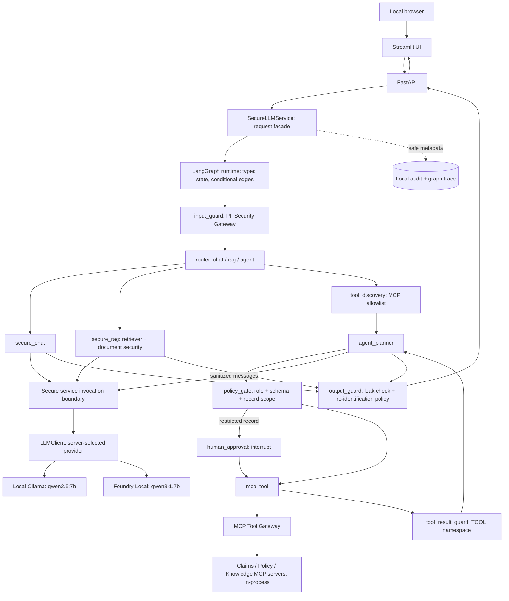

# SecureAgent-PII

**Secure Local Enterprise AI Assistant · v1.0 release candidate**

A portfolio reference implementation, not a production-ready claims system.
Start with the [five-minute demo](docs/demo-guide.md), [final architecture](architecture.md),
[production gap analysis](docs/production-readiness.md), and [release evidence](docs/phase-9-report.md).

A security-focused local enterprise AI reference implementation with secure
chat, retrieval and a bounded agent. It addresses a practical problem: an
assistant may encounter personal data in user questions, retrieved documents
and tool results. Protecting just the initial question leaves other model-input
paths exposed.

A PII Security Gateway normalizes, detects and tokenizes personal data before
local inference. SecureLLMService controls every generation call and restores
only permitted user values afterward. LangGraph orchestrates Chat, RAG and Agent
requests as an explicit state graph, and agent tools are served by local Model
Context Protocol (MCP) servers. Tool actions still require deterministic
application authorization before any MCP call. This is defense in depth, not a certified security
product or a claim that detection and prompt injection are completely solved.

**All identities, claims, policies, SSNs, emails and other personal information
included in this repository are synthetic demonstration data.** No employer or
client confidential information is required. Do not substitute real records.

## Architecture



The diagram's invocation boundary is part of the same SecureLLMService, not a
second service. LangGraph owns state and routing; MCP owns tool discovery and
invocation; deterministic application code still owns PII protection,
authorization, record scope and audit. Generation never goes directly from UI, retriever or tools to
either provider. Sanitized document/query embeddings use existing local nomic-embed-text.
See [architecture.md](architecture.md), [security boundaries](docs/security-boundaries.md)
and [data flows](docs/data-flow.md).

## Ollama and Microsoft Foundry Local

Switch the backend using configuration, with no source edits. Ollama remains the
**default** and continues to provide nomic-embed-text embeddings in both modes.
Foundry Local 0.10.3 and its one selected 1.4 GB qwen3-1.7b GPU model were verified
on this Apple Silicon Mac. Foundry Local is separate from Microsoft Foundry cloud:
no Azure subscription, API key or cloud inference is required.

```bash
# Existing Ollama mode (qwen2.5:7b).
LLM_PROVIDER=ollama python -m uvicorn app.main:app --host 127.0.0.1 --port 8000

# Foundry: installed CLI and explicitly downloaded model required first.
foundry server start
foundry model load qwen3-1.7b-generic-gpu:2
LLM_PROVIDER=foundry python -m uvicorn app.main:app --host 127.0.0.1 --port 8000

# Separate terminal, same UI command for either backend.
python -m streamlit run app/ui/app.py
```

Stop the previous backend before switching on port 8000. The provider factory
reads Foundry's dynamic endpoint once at startup; no hard-coded port, automatic
model download, model switch or remote fallback. `/health` and UI show the active
provider/model. Both modes preserve the same PII pipeline. Foundry supports Chat
and RAG; evaluated native Agent tool calling is unavailable despite catalog
advertising, so Agent returns a safe capability error. See
[Foundry setup, exact model IDs and limitations](docs/foundry-local.md) and
[Phase 7 verification report](docs/phase-7-report.md).

## LangGraph, MCP and human approval

Every request runs through one compiled LangGraph graph with explicit nodes
and conditional edges (`input_guard`, `router`, `secure_chat`, `secure_rag`,
`tool_discovery`, `agent_planner`, `policy_gate`, `human_approval`, `mcp_tool`,
`tool_result_guard`, `output_guard`, `finalize`, `safe_error`). Graph state holds
only sanitized data; token vaults, raw tool output and re-identified text live in
a request-scoped context that is never checkpointed. The three synthetic tools
are exposed by local MCP servers using the official MCP Python SDK over its
in-process JSON-RPC transport (no port, URL or subprocess). Discovered tools are
usable only if they are on the application allowlist, bound to their approved
server and match a pinned schema. Claim CLM-1004 demonstrates human approval:
for claims_adjuster the graph pauses before the MCP call until a supervisor demo
role approves. See [LangGraph + MCP design](docs/langgraph-mcp.md) and the
[Phase 8 report](docs/phase-8-report.md).

## Features and security controls

- Secure Chat and Secure RAG with either local provider; Secure Agent with native
  structured-tool-capable Ollama. Foundry Agent is safely capability-gated.
- Presidio/spaCy detection, Unicode normalization, strict SSN recognition,
  tokenization and known-value leak validation with fail-closed processing.
- Isolated request-local USER, DOC and TOOL namespaces; only permitted user
  tokens can be restored, using requested types intersected with the server ceiling.
- Whole-document sanitization before local embeddings; retrieved text protected
  again before generation; safe server-derived source references.
- Native structured tool requests, strict flat schemas, deterministic role/record
  checks, batch preflight, dispatch rechecks and bounded loops/results.
- LangGraph state graph with explicit failure edges, recursion limit and
  request-scoped in-memory checkpoints deleted after each run.
- MCP tool layer: allowlisted discovery, server binding, schema pinning, strict
  result decoding, no sampling/elicitation callbacks, in-process transport only.
- Demonstration human approval (LangGraph interrupt/resume) for a restricted
  synthetic record; bounded, expiring, single-use, memory-only pauses.
- Metadata-only audit; fixed safe API/UI errors; disabled proxies/redirects and
  enforced loopback endpoints; no automatic model download or fallback.
- Local UI with plain-text rendering, safe metadata, in-memory display history,
  clear conversation and disabled usage telemetry.
- Architecture tests and model-free CI; real local boundary verification scripts.

## Technology and project structure

| Layer | Technology |
|---|---|
| Frontend | Streamlit |
| API | FastAPI |
| PII security | Microsoft Presidio + spaCy (en_core_web_lg) |
| Agent orchestration | LangGraph 1.2.12 (in-memory checkpointer only) |
| Tool protocol | Model Context Protocol, official Python SDK `mcp` 2.3.0 (in-process transport) |
| RAG | Custom secure RAG pipeline, nomic-embed-text, standard-library SQLite |
| Inference | Ollama; Microsoft Foundry Local |
| Models | qwen2.5:7b (Ollama, default); qwen3-1.7b (Foundry Local) |
| Testing | pytest |
| CI | GitHub Actions |

LangGraph pulls in `langchain-core` as a hard dependency; no LangChain agents,
models or integrations are used, and LangSmith cloud tracing is refused at startup.
No Node, cloud SDK, paid API, external embedding service, remote MCP server or
cloud vector database.

```text
app/security/       Gateway, namespaces, secure service and restoration
app/llm/            LLMClient, provider factory, Ollama/Foundry adapters
app/rag/            Ingestion, chunking, embeddings, retrieval, SQLite
app/graph/          LangGraph state, nodes, conditional edges, runtime
app/mcp/            MCP allowlist, gateway, SDK client, host, local servers
app/agent/          Schemas, authorization, approval policy, tool policy gateway
app/tools/          Three synthetic read-only handlers
app/api/            Public contracts/routes and safe errors
app/audit/          Closed events and local sinks
app/ui/             Streamlit launcher and compatibility exports
secureagent_ui/     Independent HTTP-only UI implementation
data/documents/    Ten fictional claim/policy/customer/procedure fixtures
scripts/            Repository check and real local smoke tests
tests/              Security, unit, concurrency and startup regressions
docs/               Threat model, boundaries, flows, demo/interview guides
.github/workflows/  Model-free automated test workflow
```

## Requirements

- Recommended/verified: **Python 3.14**; local verification uses 3.14.6 on
  macOS Apple Silicon ARM64. CI targets Python 3.14 on Ubuntu 24.04.
  Metadata retains the earlier Python 3.10–3.14 range; other environments need verification.
- Ollama installed and running locally at localhost:11434.
- Already installed **qwen2.5:7b** for generation and **nomic-embed-text** for
  embeddings (Ollama may list the latter as nomic-embed-text:latest).
- Streamlit 1.64.0 and spaCy English NER model en_core_web_lg 3.8.0, installed
  by the requirements files. The NER model is a roughly 400 MB package, not an LLM.
- Network/disk capacity for dependency installation; inference itself is local.
  Binary-only installation intentionally fails if compatible wheels are absent.

## Quick Start

Clone this repository using its actual GitHub URL, or use an existing checkout.
No remote URL is hardcoded; the placeholder below must be replaced by the owner/published URL.

```bash
git clone <repository-url> SecureAgent-PII
cd SecureAgent-PII
python3 --version                     # use Python 3.14
python3 -m venv .venv
source .venv/bin/activate
python -m pip install --only-binary=:all: -r requirements-dev.txt
# requirements-dev includes runtime requirements, pytest and smoke-test helpers.
# requirements.txt already installs the official pinned spaCy English model wheel.
python -c "import en_core_web_lg; print(en_core_web_lg.__version__)"
ollama list                          # verify both required installed tags
python -m pytest -v                  # no Ollama required for these tests
python -m app.rag                    # ingest/rebuild the local synthetic index
```

If needed, start the installed Ollama app or use `ollama serve` in a separate
terminal. Missing models fail clearly; the app never pulls another model.
For additional daemon-level local-only enforcement, set `OLLAMA_NO_CLOUD=1` in
the Ollama server's environment before starting it. Setting this in the
application's .env does not reconfigure an already-running Ollama daemon.
[Ollama's local-only configuration](https://docs.ollama.com/faq#how-do-i-disable-ollama-cloud-features).
For runtime-only installation, use `python -m pip install --only-binary=:all: -r requirements.txt`.
Run all commands from the repository root. `.env` is optional; to customize,
copy `.env.example` to `.env`, then restart processes.

Terminal 1, with the virtual environment activated:

```bash
LLM_PROVIDER=ollama python -m uvicorn app.main:app --host 127.0.0.1 --port 8000
```

Terminal 2, with the same environment activated:

```bash
python -m scripts.check_runtime --provider ollama
UI_BACKEND_URL=http://127.0.0.1:8000 python -m streamlit run app/ui/app.py
```

Browser: http://127.0.0.1:8501. API health: http://127.0.0.1:8000/health.
API docs: http://127.0.0.1:8000/docs. Ollama port: 11434.

The UI launcher imports the distinct secureagent_ui package to avoid Streamlit's
app.py/backend-package name collision. No PYTHONPATH change, sys.path workaround
or editable installation is required. Stop old UI processes with Ctrl+C before
restarting: automatic file watching is intentionally disabled.

After upgrading phases, also stop the old FastAPI process with Ctrl+C and restart
it from this checkout using `python -m uvicorn app.main:app --host 127.0.0.1 --port 8000`.
A successful `/health` response proves provider availability, not API compatibility.
If the UI reports an incompatible backend, inspect `http://127.0.0.1:8000/openapi.json`:
The final application reports version `1.0.0` in health, OpenAPI and the UI.
`ChatRequest`, `RAGChatRequest`, and
`AgentChatRequest` all accept the strict boolean `include_orchestration`.
A stale Phase 5 server reports `0.5.0` and rejects that field with HTTP 422
(`body.include_orchestration`, `extra_forbidden`). Keep the Phase 8 UI payload and
strict API validation intact; restart the stale backend instead of removing the field.
See [safe port/process inspection and fresh startup](docs/startup.md) for ports
8000, 8501 and 11434. The checker is read-only; nothing automatically kills processes.

The normal pytest suite exercises all three Streamlit modes over real HTTP through
FastAPI, LangGraph, PII guards and MCP (with scripted model/retrieval boundaries).
For installed-model verification, run `python scripts/local_ui_smoke.py`; it starts
temporary servers and checks the real UI, model, retrieval, authorization and PII boundary.

## Operating modes and synthetic examples

| Mode | API | Example / behavior |
|---|---|---|
| Secure Chat | POST /api/v1/chat | Synthetic PII question below; requested restoration defaults to none |
| Secure RAG | POST /api/v1/rag/chat | What is the status of claim CLM-1001?; top_k 1–10, safe sources |
| Secure Agent | POST /api/v1/agent/chat | Same claim question as claims_adjuster; normally get_claim_status, two steps |
| Approval demo | POST /api/v1/agent/chat, then POST /api/v1/agent/approvals/{id} | CLM-1004 as claims_adjuster returns 202; a supervisor decision resumes the graph |

Add `"include_orchestration": true` to any request to receive safe LangGraph/MCP
metadata (route, node names, MCP servers, approval status). It never contains
graph state, prompts, reasoning or tool payloads.

Secure Chat:

```text
My name is David Chen. My email is david.chen@example.com. My SSN is 123-45-6789. Please acknowledge my request.
```

Generation sees tokens such as PERSON/EMAIL/SSN placeholders, not detected raw
values. The security panel contains types/flags/decisions only, not mappings.
Restoration selection is optional and still constrained by the backend ceiling.
Document/tool values are never restored through that selection.

In Agent mode the Demo Role selector offers customer_service, claims_adjuster
and supervisor. Repeat CLM-1001 under customer_service: a requested claim lookup
is denied before execution. These roles are explicitly **not authentication**.
Knowledge-search Agent answers can show safe sources using include_sources=true;
this optional API flag defaults false for earlier clients. Only source basename,
document/chunk ID and finite score are shown; no retrieved text/vector/path.

The UI displays history only in session memory and never submits it as model
context. Clear removes messages and drafts. Each backend request retains separate
vaults and IDs. User-entered or policy-approved response PII can be visible in the
trusted browser; clear is not forensic memory wiping.

## Configuration and failure behavior

[.env.example](.env.example) lists defaults and bounds. Important options:

| Setting | Default / consideration |
|---|---|
| OLLAMA_BASE_URL | http://localhost:11434; loopback only, no credentials/path/query/fragment |
| UI_BACKEND_URL | http://127.0.0.1:8000; loopback only, Ollama port rejected |
| OLLAMA_CONNECT_TIMEOUT / OLLAMA_REQUEST_TIMEOUT | 5 / 120 seconds; finite positive values, at most 3600 |
| UI_CONNECT_TIMEOUT / UI_RESPONSE_TIMEOUT | 5 / 180 seconds; at most 30 / 600 |
| PII_ENTITIES / PII_SCORE_THRESHOLD / STRICT_SSN_MODE | PERSON,EMAIL_ADDRESS,PHONE_NUMBER,US_SSN / 0.35 / true; altering these changes detection coverage |
| REIDENTIFICATION_ALLOWED_TYPES | PERSON,EMAIL_ADDRESS,PHONE_NUMBER; caller types are intersected; empty ceiling denies all |
| MAX_AGENT_STEPS / MAX_AGENT_TOOL_CALLS | 5 / 5; bounds 1–10, final answer consumes a step |
| MAX_TOOL_RESULT_CHARS | 16000; bounds 256–32000 before and after sanitization |
| RAG_CHUNK_SIZE / RAG_CHUNK_OVERLAP / RAG_TOP_K | 1000 / 150 / 3; deterministic character windows and bounded retrieval |
| RAG_INDEX_PATH / AUDIT_LOG_PATH | data/vectorstore/index.sqlite3 / logs/audit.jsonl; private generated files |
| MCP_TOOL_TIMEOUT | 30 seconds; bounds (0, 300]; there is intentionally no MCP URL setting |
| HUMAN_APPROVAL_TTL_SECONDS / MAX_PENDING_APPROVALS | 300 / 16; memory-only paused runs, single use |
| GRAPH_TRACE_LOG_PATH | logs/graph_trace.jsonl; node/route enums only, separate from the audit log |
| LANGSMITH_TRACING / LANGCHAIN_TRACING_V2 | must be unset or false; startup fails otherwise |

Sanitization/leak-check failures abort the unsafe generation path. Invalid,
denied or oversized tools do not produce unsafe follow-ups. Retrieval/model
failures return safe fixed errors, never remote fallback. API and UI clients
ignore proxy environment variables and do not follow redirects. Audit contains
only types/counts/status/latency and approved metadata; audit-sink failures retain
the prototype's continue-request policy. Counts are occurrences, not people.

.streamlit/config.toml binds to loopback, disables usage telemetry, retains
CORS/XSRF and hides exception details. Generated/user text is plain text, not
executable HTML/Markdown. Run from the root to load project configuration.
Operator overrides and unrelated browser software are outside that policy.

## Testing and repository checks

```bash
python scripts/check_repository.py
python -m compileall -q app secureagent_ui scripts tests
python -m pip check
python -m pytest -v
```

Phase 9 starts from **719 passing tests** and finishes with **733 passed** (14 new
release/privacy regressions). Real-service evidence is recorded in the
[Phase 9 report](docs/phase-9-report.md). Release tests cover
version consistency, live contract compatibility, safe stale-process diagnosis
and the version displayed by the UI. Existing security regressions remain active.
Unit/security tests intercept model HTTP bytes, exercise fail-closed behavior,
namespace/concurrency isolation, deterministic denial, audit redaction, local
routing and cold UI startup. They need the pinned spaCy model, not Ollama or
multi-GB LLM downloads. No security tests are skipped in CI.

With the existing local models and rebuilt index, developer smoke tests are:

```bash
python scripts/local_rag_smoke.py
python scripts/local_agent_smoke.py
python scripts/local_ui_smoke.py
python -m scripts.local_ui_startup_smoke
python -m scripts.local_release_smoke --provider ollama
python -m scripts.local_release_smoke --provider foundry
python -m scripts.local_provider_smoke --provider foundry
python -m scripts.local_provider_smoke --provider ollama
python -m scripts.local_phase8_smoke --provider ollama
python -m scripts.local_phase8_smoke --provider foundry
```

The scripts inspect actual local model requests without printing mappings.
Fresh startup opens a real WebSocket session and submits a chat through new API
and Streamlit processes on temporary ports. It checks the live version/contract
and completed LangGraph execution. Test-owned servers close afterward; existing
developer applications and model daemons are not stopped. Release fault tests
change only their own isolated connection/handler, never the actual model daemon.
The GitHub workflow runs checks and the full suite without installing Ollama.
Hosted CI execution must be confirmed after the owner's reviewed push.

## Security review and known limitations

[Threat model](docs/threat-model.md) covers 33 threats (nine added for LangGraph/MCP) with mitigations, residual
risk and production recommendations. [Repository hygiene](docs/repository-hygiene.md)
describes secret checking and dependency decisions. The lightweight scanner is
not proof that every secret/real identity is absent; provenance review remains necessary.

Detection is probabilistic. Obfuscated text, unusual names and unknown personal
attributes may pass; tokens do not provide anonymity. Semantic prompt injection,
incorrect answers/citations and model-invented details remain possible. Demo roles
are unauthenticated, explicit record IDs are not ownership proof, and RAG lacks
production ACLs. Local OS/processes/browser must be trusted. Audit persistence is
not mandatory, vector search is linear, HTTP response limits are checked after
reading, and the UI is synchronous with no model conversation memory.
Phase 8 approval uses demo roles, not identities, and paused runs are lost on
restart. MCP servers are first-party and in-process; a remote MCP server would
need authenticated transport and its own review. Qwen3 `<think>` reasoning
blocks are removed inside the Foundry client; an unclosed block fails closed.

## Production considerations

[Microsoft production mapping](docs/microsoft-production-mapping.md) explains how
Entra ID, approved Foundry endpoints, Search, enterprise APIs/APIM, Key Vault and
reviewed monitoring could fit. This is documentation only: no Azure service or
cloud SDK is introduced. Foundry Local is integrated separately. Copilot Studio
is **not integrated**. Microsoft Foundry cloud is also not integrated. Neither replaces this
application's PII boundary or business authorization.

The [production gap analysis](docs/production-readiness.md) separates implemented,
demonstration/local and required replacements. Production work needs verified identity, tenant/record/document permissions,
secret management, secure storage, ingress/egress/rate limits, monitoring and
mandatory audit decisions, model/data governance, formal security review,
penetration testing and compliance review. Do not use the current demo role
selector as a production access-control system.

## Demo, interview and verification reports

- [Five-minute demo](docs/demo-guide.md)
- [Concrete interview answers](docs/interview-guide.md)
- [Phase 3 report](docs/phase-3-report.md): secure local RAG
- [Phase 4 report](docs/phase-4-report.md): bounded tools
- [Phase 5 report](docs/phase-5-report.md): local UI and startup correction
- [Phase 6 report](docs/phase-6-report.md): final hardening and verification

Phase 9 is the final delivery phase: no cloud deployment, real customer API,
persistent chat store, new orchestration framework or new model is implemented.
Publication and hosted CI verification remain owner review gates; no tag or push
is performed by the release preparation.

- [Phase 7 report](docs/phase-7-report.md): second local generation provider
- [LangGraph + MCP design](docs/langgraph-mcp.md): graph, MCP layer, approval
- [Phase 8 report](docs/phase-8-report.md): LangGraph + MCP verification

- [Startup and stale-process diagnosis](docs/startup.md)
- [Production readiness](docs/production-readiness.md)
- [Release checklist](docs/release-checklist.md)
- [Phase 9 final report](docs/phase-9-report.md)
