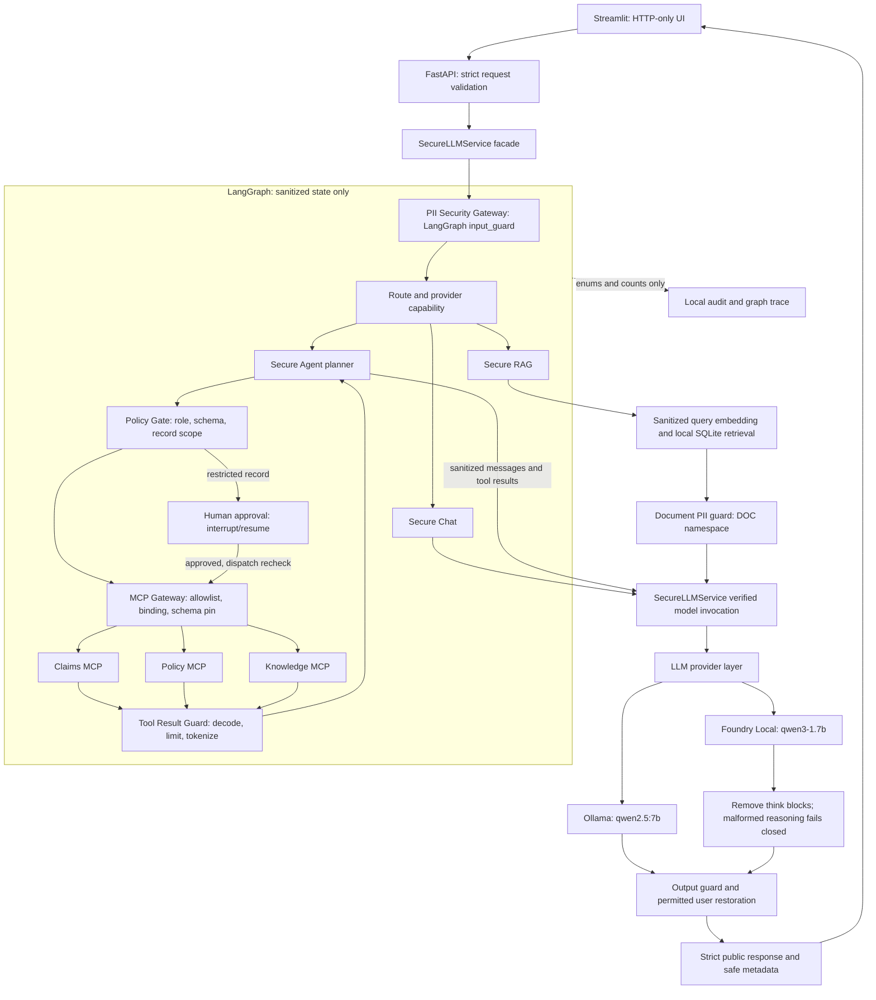

# SecureAgent-PII v1.0 architecture

A local reference implementation with one security service, one LangGraph runtime
and three first-party MCP servers. See [production gaps](docs/production-readiness.md)
before considering real data or remote deployment.

## Request and trust boundaries

This is a trust-boundary view. The PII gateway is called by the graph's first
`input_guard` node, not a new component placed before the runtime. The facade
starts the graph with raw input in non-checkpointed request context; graph state
receives only sanitized text. The diagram's model/output edge represents final
answers: Agent tool proposals instead return to `policy_gate` before dispatch.
Every generation call, including Agent planning/follow-ups, passes through the
same verified service boundary. MCP servers never call an LLM.

## Deterministic controls relative to the model

| Stage | Enforcement outside model discretion |
|---|---|
| API entry | Pydantic strict option types, length/enum bounds, forbidden extra fields; safe validation errors omit input values |
| Before planning/generation | Normalize, detect with Presidio/spaCy, tokenize, verify known protected values; derive explicit record scope |
| After model proposes tools | Role permissions, fixed tool/argument schemas, one-record scope, budgets and approval policy |
| Before MCP execution | Recheck authorization/scope/approval; bind approved tools to configured servers and pinned schemas |
| After MCP output | One bounded JSON object, allowlisted failures, structural leaf sanitization, TOOL namespace; no error text reaches the model |
| Before RAG generation | Revalidate source metadata and protect retrieved text again; document content is untrusted data |
| Before final delivery | Known-value checks; user restoration requested types intersect server ceiling; no DOC/TOOL restoration; Foundry reasoning removed |
| Throughout | Fixed public errors, closed audit/trace schema, local-only endpoints, no proxy/redirect or remote fallback |

Prompt instructions are supplementary. The model cannot grant roles, approve
itself, expand record scope or bypass the gateways. A caller can still choose an
unauthenticated **demo role**; naming a record is not ownership proof.

## State, transport and data

- LangGraph: explicit Chat/RAG/Agent branches, bounded loops, safe-error edges,
  per-request in-memory checkpoints. Vaults, raw tool output and re-identified
  text remain outside state in short-lived context; cleanup on completion/failure.
- Approval: CLM-1004 requires a supervisor demo decision for claims_adjuster.
  Pauses are bounded, expiring, single-use and memory-only; restart loses them.
- MCP: official SDK JSON-RPC over in-process memory transport. Claims, policy and
  knowledge use a single registry dispatch site in the host. No remote listener,
  stdio subprocess, sampling, elicitation or roots access.
- Ingestion: untrusted synthetic documents → whole-document PII guard → chunks
  → local nomic-embed-text embeddings → local SQLite. Both generation providers
  retain Ollama embeddings. Retrieved chunks are protected again.
- Namespaces: request USER values may be restored under policy; DOC and TOOL
  values remain protected. Literal placeholder-like text cannot acquire mappings.
- UI: `secureagent_ui` imports public HTTP contracts only, renders dynamic text
  plainly and stores display history in session memory; it sends no chat history.
- Release identity: `app/version.py` drives FastAPI/OpenAPI, health and MCP server
  identity; package metadata is regression-checked against it. UI reads the live
  version/provider. `scripts.check_runtime` verifies the running contract.

Local OS/process/browser trust is required. Detection misses, semantic injection,
hallucination, missing retrieval ACLs, resource limits and audit persistence policy
remain material limitations. No cloud service, additional model/framework/database
or Copilot Studio integration is introduced in v1.0.

Detailed references: [LangGraph/MCP](docs/langgraph-mcp.md),
[security boundaries](docs/security-boundaries.md), [data flows](docs/data-flow.md),
[threat model](docs/threat-model.md), [release evidence](docs/phase-9-report.md).
Historical implementation notes remain in the phase reports.
